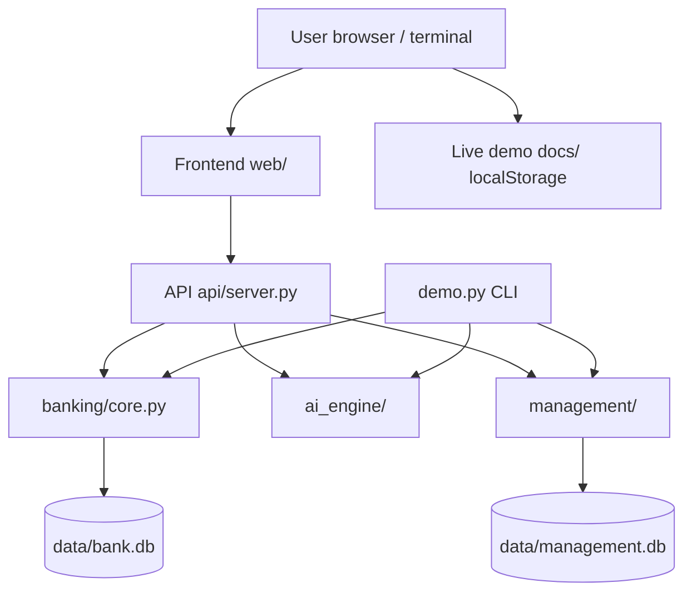

# AI Banking System — Architecture and How It Works

> **DEMO / EDUCATIONAL ONLY.** This document describes the system as it
> actually ships in this repo. Every component, endpoint, table, and flow
> below exists in the code. Nothing here is aspirational: if a feature is
> not in the code, it is listed under Limitations in the README, not
> drawn as if it existed.

Start with the [README](README.md) for run instructions. This document
explains **how the system works, end to end**.

## 1. System architecture diagram

```
                        ┌─────────────────────────────────────────┐
                        │        USER (browser / terminal)        │
                        └───────┬─────────────────────────┬───────┘
                                │                         │
                 Python stack (local)          Live Pages demo (browser only)
                                │                         │
        ┌───────────────────────▼───────────────────┐     ┌────────▼────────┐
        │  FRONTEND  web/index.html + app.js        │     │ docs/index.html │
        │  Dashboard, Accounts, Transactions,       │     │ + app.js        │
        │  Transfers, Fraud Review, Loans,          │     │ (same views,    │
        │  Management — canvas charts, tables,      │     │  localStorage,  │
        │  login screen, role-gated nav             │     │  no server)     │
        └───────────────────────┬───────────────────┘     └─────────────────┘
                                │  fetch() JSON, Bearer token
        ┌───────────────────────▼───────────────────┐
        │  API LAYER  api/server.py (http.server)   │
        │  Routing, JSON in/out, auth check,        │
        │  role checks (403), error codes,          │
        │  serves web/ static files at /            │
        └───────┬───────────────┬───────────┬───────┘
                │               │           │
   ┌────────────▼─────┐ ┌───────▼──────┐ ┌──▼──────────────┐
   │ SERVICES         │ │ AI ENGINE    │ │ MANAGEMENT      │
   │ banking/core.py  │ │ ai_engine/   │ │ management/     │
   │ Bank: accounts,  │ │ fraud.py     │ │ auth.py (roles, │
   │ deposits,        │ │ credit.py    │ │  PBKDF2)        │
   │ withdrawals,     │ │ insights.py  │ │ kyc.py, loans.py│
   │ transfers,       │ │ assistant.py │ │ audit.py,       │
   │ interest,        │ │              │ │ reports.py      │
   │ statements       │ │              │ │                 │
   └────────────┬─────┘ └──────────────┘ └────────┬────────┘
                │                                 │
   ┌────────────▼─────────────────────────────────▼────────┐
   │  DATABASE LAYER — SQLite (created on first run)       │
   │  data/bank.db        data/management.db               │
   │  customers, accounts, transactions   users, customers  │
   │                                      (KYC), loans,     │
   │                                      audit_log         │
   └───────────────────────────────────────────────────────┘
```



The same `banking/`, `ai_engine/`, and `management/` code is used by
three entry points: the API server (`api/server.py`, via `run.py`),
the CLI demo (`demo.py`), and the tests. There is no second backend.

## 2. Component map

| Component | Files | What it does | How it talks to others |
|---|---|---|---|
| Frontend (Python stack) | `web/index.html`, `web/app.js`, `web/style.css` | Dashboard UI: login screen, 7 views (Dashboard, Accounts, Transactions, Transfers, Fraud Review, Loans, Management), summary cards, canvas charts, tables, role-gated nav. No external libraries or CDNs. | `fetch()` JSON to `/api/*` with `Authorization: Bearer <token>`. Served as static files by `api/server.py` at `/`. |
| Frontend (Pages demo) | `docs/index.html`, `docs/app.js`, `docs/style.css` | Same views (plus a Credit view), re-implemented in vanilla JS. State in `localStorage` key `aiBankingDemoV1`. No server, no fetch. | Talks to nothing. Charts and tables read the in-browser state. |
| API layer | `api/server.py`, `api/seed.py` | Routing, JSON parsing/serialising, bearer-token auth (tokens in server memory only), role checks, error codes (400/401/403/404), audit logging on actions, static file serving. One shared `Bank` instance and one set of management stores. | Imports `banking`, `ai_engine`, `management` directly (plain Python calls, no network between layers). |
| Core banking service | `banking/core.py` (`Bank`) | Customers, checking/savings accounts, deposit, withdraw, transfer, history, savings interest, monthly statements. | Own SQLite connection to `data/bank.db`. Returns plain dicts. |
| AI engine | `ai_engine/fraud.py`, `credit.py`, `insights.py`, `assistant.py` | Fraud scoring, credit scoring, categorisation/insights, FAQ assistant. Pure stdlib math/rules only. | Pure functions over plain dicts/lists. No database of its own; the API feeds it transaction history. |
| Management | `management/auth.py`, `kyc.py`, `loans.py`, `audit.py`, `reports.py` | Users/roles/passwords, KYC records, loan workflow, audit log, reports. | Own SQLite stores in `data/management.db` (separate file from `bank.db`). |
| Seed data | `api/seed.py` | Fictitious demo customers, accounts, transactions (including one deterministically flagged $8,500 withdrawal), demo users, demo loans, KYC records. Runs only if the databases are empty (or on `--reset`). | Called by `run.py` before serving. |
| CLI demo | `demo.py` | End-to-end scenario against a temporary database, deleted afterwards. | Imports `banking`, `ai_engine`, `management` directly. |
| Entry points | `run.py` (server), `demo.py` (CLI), `python -m unittest discover -s tests` (tests) | The only three commands a user needs. | — |

## 3. Request / data flows, end to end

### 3.1 A transfer, from click to database to audit

1. **Click (frontend).** In the Transfers view, the user picks a from/to
   account, an amount, and a description, and submits. `web/app.js`
   sends `POST /api/transfers` with the Bearer token and a JSON body.
2. **API auth + visibility (api/server.py).** The handler checks the
   Bearer token (401 if missing/invalid), then checks the user may act
   on the from-account: customers may only use their own accounts
   (403 otherwise); teller/manager/admin may use any.
3. **Service (banking/core.py `Bank.transfer`).** Inside a **single
   SQLite transaction**, the handler: validates both accounts exist
   (`LookupError` → 404), the amount is positive, the accounts differ,
   and the from-balance covers the amount (`ValueError` → 400);
   debits the from-account and credits the to-account (balances stored
   as integer cents); inserts two transaction rows (a transfer-out and
   a transfer-in, each with `balance_after_cents`); commits both
   together. On any failure the whole transaction rolls back, so a
   failed transfer leaves both balances unchanged (covered by tests).
4. **Audit (management/audit.py).** The API appends an audit event
   (`actor` = username, `action` = `transfer`, `details` = from/to
   account IDs and amount — never passwords or hashes) to
   `data/management.db`'s `audit_log`.
5. **Response + UI refresh.** The API returns both transaction dicts.
   The frontend reloads balances, history, and charts from the API, so
   the new transfer appears in the Transactions table and in the
   balance-over-time chart.

The same path, minus the HTTP layer, is what `demo.py` exercises
directly against `Bank`.

### 3.2 A fraud-flagged transaction, from scoring to review queue

1. **Scoring is computed, not stored.** Banking transactions carry no
   fraud fields. When the Fraud Review view loads, the frontend calls
   `GET /api/fraud/review`. The API fetches every transaction, and for
   each one calls `ai_engine.fraud.score_transaction(txn, history)`,
   where `history` is that account's *prior* transactions.
2. **Scoring rules (all reported as reasons).** Amount vs. the account's
   median amount (≥2× +15, ≥3× +25, ≥5× +35, ≥10× +45); velocity in the
   prior 60 minutes (≥3 +15, ≥5 +25, ≥10 +35); unusual hour 00:00–04:59
   (+15); repeated same amount in 24 h (2× +10, ≥3× +20); new location
   (+15) / new category (+10). Score is capped at 100.
3. **Flagging.** Score ≥ 70 (`FRAUD_THRESHOLD`) ⇒ `flagged = True`.
   The review endpoint returns only flagged items, each with its score
   and reasons. The seeded demo contains exactly one: an $8,500
   withdrawal that scores above the threshold on every verified run
   (large amount + high velocity + unusual hour; the exact score
   varies slightly with velocity timing — 80 in the builder's run,
   95 in the coordinator's verification run) — in the CLI demo, a
   $5,000 transaction after twelve $50 transactions scores 95
   (100× typical + velocity + unusual hour).
4. **Review queue (UI).** The Fraud Review table lists flagged
   transactions with score and reasons. Review here means *inspect*:
   this demo has no block/unblock action on a transaction — a flagged
   transaction is a signal for a human, not an automated freeze. (The
   Pages demo computes the same kind of score in JS and shows the same
   queue from its localStorage data.)

### 3.3 A loan, from application to manager approval

1. **Application.** A customer (or staff) submits
   `POST /api/loans` with customer, amount, purpose, term, and
   optionally a credit-score input. The API validates a positive
   amount/term and a 300–850 score if given, then
   `management/loans.py` inserts a loan with `status = pending`.
   An audit event (`loan_application`) is appended.
2. **Pipeline.** `GET /api/loans` lists loans; customers see only their
   own (filtered by `customer_id`); staff see all. The Loans view
   renders them as a pipeline table (pending / approved / rejected).
3. **Review.** A manager or admin submits
   `POST /api/loans/<id>/review` with `approve` or `reject` and a note.
   The API enforces manager/admin only (403 for anyone else,
   including the customer). `review_loan` records reviewer, note, and
   timestamp, and moves the loan to `approved` or `rejected`.
   Re-reviewing a decided loan raises `ValueError` (400) — a decided
   loan is terminal.
4. **Audit + reports.** A `loan_review` audit event is appended, and
   the loan appears in `GET /api/reports`' loan-pipeline report
   (counts by status, totals requested/approved/pending, approval
   rate). The credit score shown alongside a loan application is the
   illustrative `ai_engine` score (see §5.2) — it is an input to the
   demo record, not a lending decision.

## 4. Database schema

Two SQLite files, created on first run. No migrations, no ORM — plain
`sqlite3` with parameterised queries.

### `data/bank.db` (banking/core.py)

```sql
customers (
    id INTEGER PRIMARY KEY AUTOINCREMENT,
    name TEXT NOT NULL,
    email TEXT NOT NULL,
    created_at TEXT NOT NULL
);
accounts (
    id INTEGER PRIMARY KEY AUTOINCREMENT,
    customer_id INTEGER NOT NULL REFERENCES customers(id),
    account_type TEXT NOT NULL,          -- 'checking' or 'savings'
    account_number TEXT NOT NULL UNIQUE, -- 'DEMO-' + 10 random digits
    balance_cents INTEGER NOT NULL DEFAULT 0,  -- money as integer cents
    status TEXT NOT NULL DEFAULT 'open',
    created_at TEXT NOT NULL
);
transactions (
    id INTEGER PRIMARY KEY AUTOINCREMENT,
    account_id INTEGER NOT NULL REFERENCES accounts(id),
    type TEXT NOT NULL,                  -- deposit, withdrawal, transfer_out,
                                         -- transfer_in, interest
    amount_cents INTEGER NOT NULL,
    balance_after_cents INTEGER NOT NULL,
    description TEXT NOT NULL DEFAULT '',
    timestamp TEXT NOT NULL              -- UTC, second precision
);
-- index: (account_id, timestamp, id) for history queries
```

Relationships: one customer → many accounts; one account → many
transactions. Money is stored as integer cents and returned as
2-decimal floats, so no floating-point rounding accumulates in
balances. Timestamps are UTC, second precision; same-second ordering
is broken deterministically by transaction id.

### `data/management.db` (management/*.py)

```sql
users (                          -- management/auth.py
    id INTEGER PRIMARY KEY AUTOINCREMENT,
    username TEXT UNIQUE NOT NULL,
    password_hash TEXT NOT NULL, -- pbkdf2_sha256$iterations$salt$hash
    role TEXT NOT NULL,          -- customer, teller, manager, admin
    customer_id INTEGER          -- links a customer login to a banking customer
);
customers (                      -- management/kyc.py (SEPARATE table from bank.db)
    id INTEGER PRIMARY KEY AUTOINCREMENT,
    name TEXT NOT NULL, email TEXT NOT NULL,
    dob TEXT NOT NULL, address TEXT NOT NULL,
    id_type TEXT NOT NULL,
    id_number_hash TEXT NOT NULL, -- SHA-256 hash ONLY, never the raw ID number
    kyc_status TEXT NOT NULL DEFAULT 'pending',  -- pending, verified, rejected
    reviewed_by TEXT, reviewed_at TEXT, created_at TEXT NOT NULL
);
loans (                          -- management/loans.py
    id INTEGER PRIMARY KEY AUTOINCREMENT,
    customer_id INTEGER NOT NULL,
    amount REAL NOT NULL, purpose TEXT NOT NULL, term_months INTEGER NOT NULL,
    credit_score INTEGER,        -- optional illustrative score, 300-850 if given
    status TEXT NOT NULL DEFAULT 'pending',  -- pending, approved, rejected
    reviewer TEXT, note TEXT, created_at TEXT NOT NULL, reviewed_at TEXT
);
audit_log (                      -- management/audit.py
    id INTEGER PRIMARY KEY AUTOINCREMENT,
    actor TEXT NOT NULL, action TEXT NOT NULL, details TEXT NOT NULL,
    timestamp TEXT NOT NULL,
    previous_hash TEXT NOT NULL, -- hash of the previous entry (64 zeroes for genesis)
    hash TEXT NOT NULL           -- SHA-256 over prev_hash + actor + action + details + timestamp
);
```

Note the two `customers` tables are **intentionally separate**: the
banking customers table holds accounts' owners, while the management
customers table holds KYC records. They are linked in practice by the
demo seed using the same people, and by `users.customer_id` for
customer logins — there is no foreign key across the two database
files (SQLite cannot enforce cross-file foreign keys). Reports
(`management/reports.py`) take plain lists/dicts as input and do not
import banking or AI internals.

## 5. How the AI pieces actually work, step by step

All AI code is hand-written rules and arithmetic in pure Python. There
are no ML libraries, no trained models, no external AI services, and
no data leaves the machine.

### 5.1 Fraud scoring (`ai_engine/fraud.py`)

Input: one transaction dict (amount, account, timestamp, optional
location/category) plus that account's prior transaction list.

1. Compute the account's median prior amount (if there is no history,
   a large amount ≥ 10,000 contributes only +10 with an explicit
   "no prior history" reason).
2. Add points per rule (§3.2): amount-vs-median, 60-minute velocity,
   00:00–04:59 hour, repeated amounts in 24 h, new location/category.
   Every point source is appended to `reasons` as a human-readable
   sentence.
3. Cap at 100. Flag if score ≥ 70.
4. Output: `(score, flagged, reasons)`. `review_queue` simply filters
   a transaction list through this scorer (or passes through items
   already carrying a flag/score).

Limit: thresholds (70, velocity windows, hour band) are demo choices,
not tuned on real data. With no history, scoring is weak by design.

### 5.2 Credit scoring (`ai_engine/credit.py`)

Input: a features dict — `income`, `monthly_debt`,
`employment_years`, `past_defaults`, `open_loans`, `savings_balance`
(missing = 0).

1. Start at base score **350**.
2. Add one contribution per factor (income band, debt burden as
   monthly debt ÷ monthly income, employment years, past defaults,
   open loans, savings balance). Each contribution is recorded as a
   dict and explained in `reasons`, e.g. "+90 points: No past
   defaults."
3. Clamp the total to **300–850** and map to a band: ≥750 Excellent,
   ≥650 Good, ≥550 Fair, otherwise Poor.
4. Output: `{score, band, reasons, contributions, base_score}`, with
   `base + sum(contributions) == score` unless clamping applied.

This is an illustration of *explainable* scoring (every point is
accounted for), not a lending model: it uses no bureau data, no real
lending criteria, and must not be used for real credit decisions.

### 5.3 Spending categorisation and insights (`ai_engine/insights.py`)

- `categorise(description)`: ordered keyword rules — e.g. "Uber Eats"
  → dining (checked before transport), grocery keywords → groceries,
  salary keywords → salary, unmatched → `other`. Keyword matching
  only; novel merchant names fall back to `other`.
- `spending_insights(transactions)`: totals by category (salary
  excluded from spending totals), top categories largest-first,
  `month_total` for the latest dated month present, monthly totals,
  transaction count, and plain-language insights: largest category
  (and its share when ≥ 50%), a spike note when the latest month is
  ≥ 1.5× the prior-months average, and a salary total note when
  present.

### 5.4 Banking assistant (`ai_engine/assistant.py`)

- A built-in FAQ of **14 entries** (accounts, transfers and limits,
  interest, fraud flags, reporting fraud/lost cards, loans, KYC,
  statements, contact details, closing an account, passwords/access,
  overdrafts, direct debits/standing orders).
- Matching is keyword overlap: ≥ 2 shared keywords, or 1 distinctive
  keyword (e.g. `kyc`, `fraud`, `loan`). The answer is returned with
  its source titles (`(answer, source_titles)`).
- On no good match it **declines** — it states it has no answer in the
  demo knowledge base, lists suggested topics, and returns no sources.
  It never invents a policy, rate, or fee figure, and answers
  deliberately quote no specific rates/fees.

## 6. Security design (and its limits — read this)

- **Passwords:** PBKDF2-HMAC-SHA256, 200,000 iterations, fresh
  16-byte random salt per user, stored as
  `pbkdf2_sha256$iterations$salt_hex$hash_hex`. Passwords are never
  stored or returned in plaintext; login responses contain only a
  token, username, and role. PBKDF2 via stdlib is adequate for a demo;
  production would use a dedicated identity provider, rate limiting,
  lockout, and MFA (none of which exist here).
- **Tokens:** `secrets.token_hex` bearer tokens held only in server
  memory. Restarting the server invalidates all logins. There is no
  HTTPS, no token expiry, no refresh, and no rate limiting in this
  demo server.
- **Roles:** `customer`, `teller`, `manager`, `admin`, enforced in
  two places — the API (403 on violation) and the frontend nav (hidden
  views). Customers see only their own accounts/transactions/loans
  (filtered server-side by `customer_id`); only manager/admin may
  review loans or read reports; only admin may manage users. The
  Pages demo's role switcher is **not** enforcement — it is a UI gate
  over data already in the browser.
- **KYC data:** ID numbers are stored only as SHA-256 hashes, never
  raw. KYC here is record-keeping (status + reviewer + timestamp),
  not real identity verification.
- **Audit chain:** each entry's SHA-256 covers the previous entry's
  hash plus actor, action, details, and timestamp, starting from a
  genesis previous-hash of 64 zeroes. `verify_chain()` recomputes
  every link and reports `(ok, first_bad_index)`. This makes tampering
  **detectable**, not impossible: anyone with write access to the
  SQLite file could rewrite the whole chain. Production would need
  append-only storage, signing, and independent retention.
- **Validation:** positive amounts only, sufficient-funds checks,
  no self-transfers, atomic transfers (single SQLite transaction),
  parameterised SQL throughout (no string-built queries).

## 7. Live Pages demo vs. full Python stack

| | Pages demo (`docs/`) | Full Python stack |
|---|---|---|
| Runs where | In the visitor's browser, from GitHub Pages | On the user's computer (`python run.py`) |
| Frontend | `docs/index.html` + `app.js` + `style.css` | `web/index.html` + `app.js` + `style.css` (same views + Management/Audit views) |
| Backend | None | `api/server.py` + `banking/` + `ai_engine/` + `management/` |
| Data | `localStorage` key `aiBankingDemoV1`, seeded in-browser | SQLite `data/bank.db` + `data/management.db` |
| Fraud / credit | Re-implemented in JavaScript with the same style of transparent rules (threshold 70; credit bands Poor <580, Fair 580–669, Good 670–739, Excellent 740+) | Python `ai_engine` (threshold 70; credit bands Poor <550, Fair 550–649, Good 650–749, Excellent 750+) — note the credit bands differ slightly between the two implementations; both are illustrative only |
| Auth / roles | Role switcher UI gate only | Bearer tokens + server-side role checks |
| Audit | Not present (no server log) | Hash-chained `audit_log` with verification |
| Use it when | You want to try it instantly with no install | You want the API, real roles, audit, CLI demo, and tests |

The Pages demo is **not** a frontend for the Python server — the two
do not communicate. They share the demo concept, the view layout, and
the transparent-scoring approach, but they are independent
implementations. Do not present Pages demo results as Python server
results, or vice versa.

## 8. What is deliberately NOT in this system

No real payments or payment rails, no external bank APIs, no HTTPS/
TLS termination, no email/SMS, no scheduled jobs, no multi-process
concurrency (the server is single-threaded by design around one
SQLite connection), no interest auto-accrual on server start, no
block/unblock action on flagged transactions, no idempotency keys,
and no production deployment configuration. Anything in that list
would be a new project, not a missing README paragraph.
